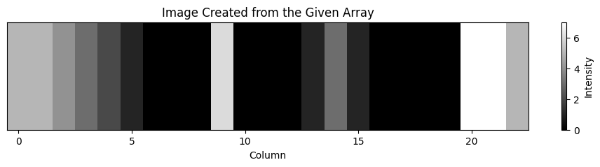
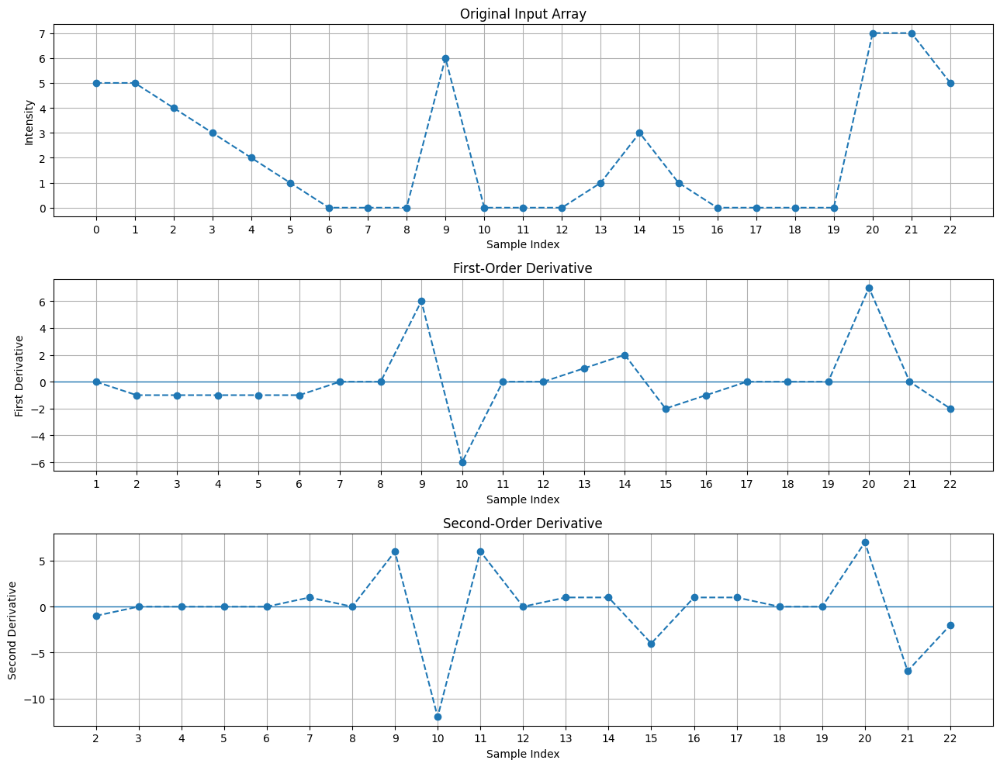
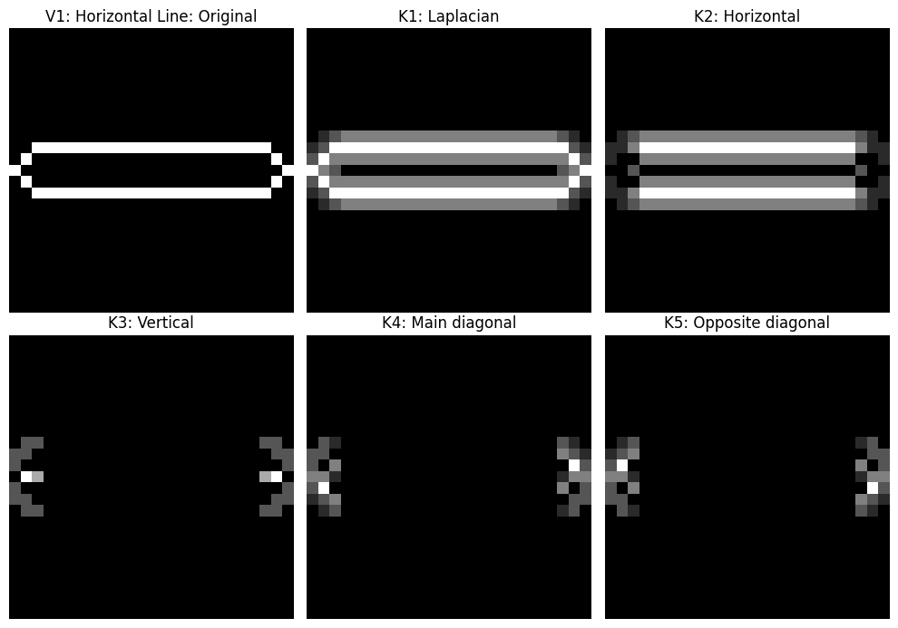
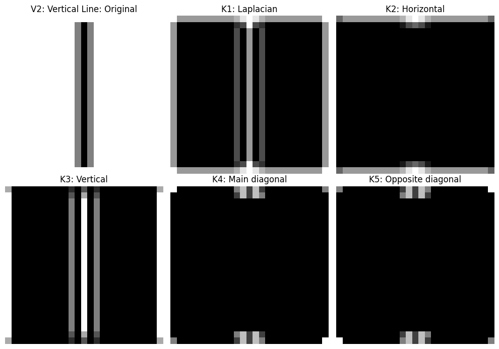
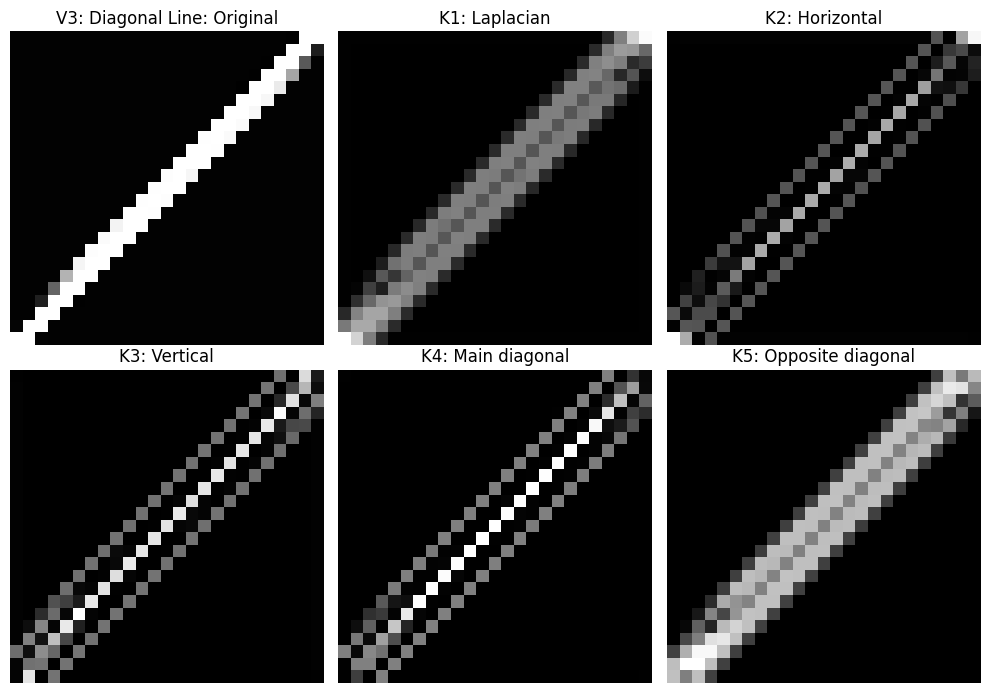

## 1. Overview
1. Representing a one-dimensional intensity array as a grayscale image.
2. Computing and plotting first-order and second-order derivatives of an intensity signal.
3. Applying spatial convolution/correlation-style filtering with Laplacian and directional 3 × 3 kernels to horizontal, vertical, and diagonal line images.

## 2. Objectives

- Convert a given intensity array into a grayscale image.
- Calculate first-order and second-order finite differences.
- Understand how derivatives respond to intensity changes.
- Observe the response of a Laplacian kernel to edges in different directions.
- Compare horizontal, vertical, main-diagonal, and opposite-diagonal directional kernels.
- Understand how image orientation affects the filter response.

## 3. Part A — Displaying a 1D Intensity Array as an Image

### Result: `array_image.png`

### What the image shows

Each array value becomes the intensity of one pixel:

- `0` is black.
- Larger values are brighter.
- `7` is the brightest intensity in this data.
- Repeated zeros appear as continuous black regions.
- The values `5, 5, 4, 3, 2, 1` appear as a gradually darkening sequence.
- The value `6` appears as a bright pixel after a black region.
- The final values `7, 7, 5` form a bright region at the right.

## 4. Part B — First-Order and Second-Order Derivatives

### First-order derivative

The program uses the forward finite difference:

\[
D_1[i] = I_p[i+1] - I_p[i]
\]

- A positive value means intensity increases from one sample to the next.
- A negative value means intensity decreases.
- Zero means the neighboring samples have equal intensity.
- A large magnitude indicates a sharp intensity transition.

For example, the transition from `0` to `6` produces a derivative of `+6`; the transition from `6` to `0` produces `-6`. These large positive and negative responses indicate strong changes in intensity.

### Second-order derivative

The second derivative is the difference between neighboring first-order derivative values:

\[
D_2[i] = D_1[i+1] - D_1[i]
\]

- The second derivative measures how the first derivative changes.
- It produces strong positive or negative responses around abrupt intensity changes.
- Constant-intensity regions generally have a zero second derivative.
- A transition may produce a pair of responses with opposite signs around a sharp change.

## 5. The Five Kernels

The program applies five 3 × 3 kernels to each test image.

### K1 — Laplacian kernel

\[
K_1 =
\begin{bmatrix}
1 & 1 & 1\\
1 & -8 & 1\\
1 & 1 & 1
\end{bmatrix}
\]

This kernel compares the center pixel with all eight surrounding pixels. It responds to intensity changes in multiple directions, so it can highlight horizontal, vertical, and diagonal boundaries.

The positive and negative responses occur on opposite sides of transitions. The program displays the absolute response, so both signs appear bright.

### K2 — Horizontal-direction kernel

\[
K_2 =
\begin{bmatrix}
-1 & -1 & -1\\
2 & 2 & 2\\
-1 & -1 & -1
\end{bmatrix}
\]

This kernel compares the middle row with the rows above and below it. It is designed to respond strongly to horizontal line-like structures and intensity patterns that vary vertically.

### K3 — Vertical-direction kernel

\[
K_3 =
\begin{bmatrix}
-1 & 2 & -1\\
-1 & 2 & -1\\
-1 & 2 & -1
\end{bmatrix}
\]

This kernel compares the center column with the columns on either side. It responds strongly to vertical line-like structures and patterns that vary horizontally.

### K4 — Main-diagonal kernel

\[
K_4 =
\begin{bmatrix}
2 & -1 & -1\\
-1 & 2 & -1\\
-1 & -1 & 2
\end{bmatrix}
\]

The positive weights lie along the main diagonal from top-left to bottom-right. This makes the kernel particularly responsive to intensity patterns aligned with that diagonal, although it also responds to other local intensity changes.

### K5 — Opposite-diagonal kernel

\[
K_5 =
\begin{bmatrix}
-1 & -1 & 2\\
-1 & 2 & -1\\
2 & -1 & -1
\end{bmatrix}
\]

The positive weights lie along the opposite diagonal from top-right to bottom-left. It is designed to respond to intensity patterns aligned with this diagonal.

**Note:** K2–K5 are directional line/pattern-response kernels. Their outputs should not be interpreted as perfect orientation classifiers: each kernel can respond to line boundaries, nearby structures, and other local intensity variations.

## 6. Results and Detailed Observations

### Experiment 1 — V1: Horizontal Line

**Original image**

The input contains a bright horizontal line on a dark background. The line has an upper and a lower boundary, where the intensity changes from dark to bright and then from bright to dark.

**K1 — Laplacian**

The Laplacian responds to the line's upper and lower boundaries. Because it detects changes in all directions, it highlights the outline of the horizontal line rather than only one orientation.

**K2 — Horizontal kernel**

The response is strong along the horizontal structure because the middle row of the kernel has positive weights and the neighboring rows have negative weights. The contrast between the line and its surroundings produces a visible response.

**K3 — Vertical kernel**

This kernel is more sensitive to vertical structures. A long horizontal line is not aligned with its preferred pattern, so the response is concentrated mainly around the line's ends and local boundary variations.

**K4 — Main-diagonal kernel**

The diagonal kernel is not aligned with the horizontal line. Its response is influenced by the line's boundaries and the diagonal weighting pattern, particularly near the ends.

**K5 — Opposite-diagonal kernel**

This kernel also responds to local changes around the line, but its opposite-diagonal weighting pattern does not align with the horizontal line. Responses can appear near the ends and boundaries.

**Overall observation:** The horizontal kernel responds to the horizontal line pattern, while the other kernels respond according to their weighting arrangements and to the line's boundaries.

### Experiment 2 — V2: Vertical Line

**Original image**

The input contains a dark vertical line on a bright background. Its left and right boundaries create strong intensity changes.

**K1 — Laplacian**

The Laplacian highlights both sides of the vertical line because it responds to intensity changes in multiple directions.

**K2 — Horizontal kernel**

This kernel compares the center row with the rows above and below. Since the main structure is vertical, its response differs from that of the vertical kernel and can be more visible around horizontal transitions, including the ends of the line.

**K3 — Vertical kernel**

The positive weights are in the center column, with negative weights on either side. This makes the kernel well suited to detecting the vertical line pattern. Its response emphasizes the line and its boundaries.

**K4 — Main-diagonal kernel**

The main-diagonal kernel is not specifically aligned with the vertical structure. Its response mainly reflects local intensity differences, including boundary and border effects.

**K5 — Opposite-diagonal kernel**

The opposite-diagonal kernel also responds to local intensity variations, but it is not specifically aligned with the vertical line.

**Overall observation:** The vertical kernel is designed for vertical line patterns, whereas the Laplacian detects boundaries without preferring one orientation.

### Experiment 3 — V3: Diagonal Line

**Original image**

The input contains a bright line running diagonally from the bottom-left toward the top-right. Its orientation makes it useful for examining diagonal kernels.

**K1 — Laplacian**

The Laplacian responds to the two sides of the diagonal line. It does not need to know the line's direction because it responds to local second-order intensity changes in multiple directions.

**K2 — Horizontal kernel**

The horizontal kernel responds to the line's local pattern and boundaries. Because the line is diagonal rather than horizontal, the response may be distributed along the diagonal rather than appearing as a perfectly uniform line.

**K3 — Vertical kernel**

The vertical kernel also produces a response along the diagonal structure because the local neighborhoods contain intensity transitions in both horizontal and vertical directions.

**K4 — Main-diagonal kernel**

The main-diagonal kernel's positive weights align with the top-left-to-bottom-right direction. The input line runs in the opposite diagonal direction, so the response depends on the line's orientation, its width, and the local boundary intensities.

**K5 — Opposite-diagonal kernel**

The positive weights align with the top-right-to-bottom-left direction, matching the orientation of the bright diagonal line in the displayed input. This produces a strong response along the line-like structure.

**Overall observation:** The diagonal kernels distinguish local diagonal patterns through their weight placement. The strongest response depends on the exact image, line polarity, orientation, width, and boundary pixels.

