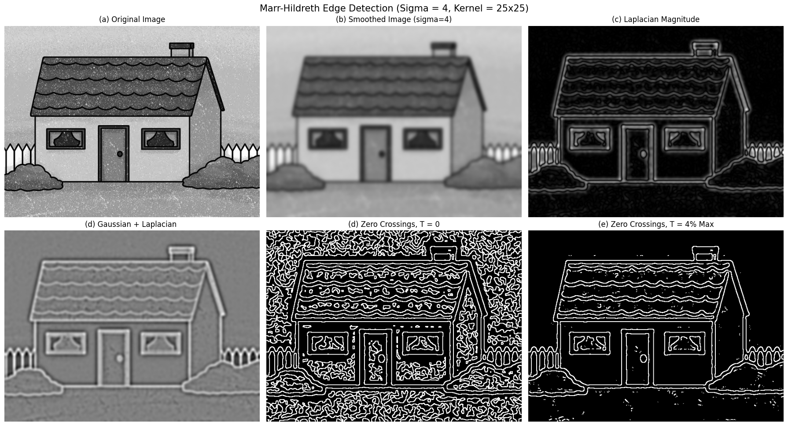
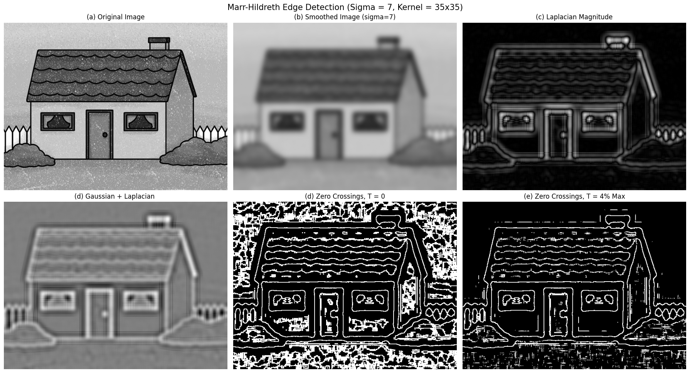
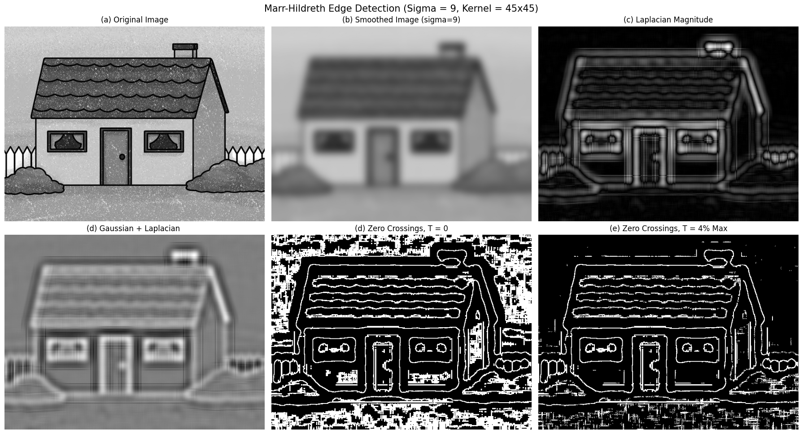

# Marr–Hildreth Edge Detection Using Gaussian and Laplacian Filters

## 1. Project Overview

The  **Marr–Hildreth algorithm** detects edges in an image using Gaussian smoothing, the Laplacian operator, and zero-crossing detection. It is based on the idea that edges correspond to locations where the second derivative of the smoothed image changes sign.

In this project, the algorithm is applied to a grayscale image of a house. Different values of sigma and Gaussian kernel size are used to study their effects on noise reduction, edge detection, and preservation of image details.

## 2. Theory: Marr–Hildreth Edge Detection

The Marr–Hildreth algorithm consists of three main operations:

### Step 1: Gaussian Smoothing

A Gaussian filter is applied to the input image to reduce noise and small intensity variations.

The Gaussian function is given by:

G(x,y) = 1/(2πσ²) × e^(-(x²+y²)/(2σ²))

Here, sigma controls the amount of smoothing.

- Small sigma preserves more fine details but may retain noise.
- Large sigma produces stronger smoothing but may remove small details.

### Step 2: Laplacian Operation

The Laplacian operator calculates the second-order spatial derivative of the smoothed image.

∇²I = (∂²I/∂x²) + (∂²I/∂y²)

In this project, the Laplacian is calculated using:

`cv2.Laplacian(smoothed, cv2.CV_64F, ksize=3)`

The output contains positive and negative responses around intensity transitions. Large response magnitudes generally indicate strong intensity changes.

### Step 3: Zero-Crossing Detection

Zero crossings are locations where the Laplacian response changes sign between neighboring pixels.

For example, a transition from a negative value to a positive value may indicate an edge.

Two zero-crossing results are generated:

- **Threshold T = 0:** Detects sign changes without requiring a minimum response difference.
- **Threshold T = 4% of maximum:** Detects sign changes only when the absolute difference between neighboring Laplacian responses exceeds 4% of the maximum absolute Laplacian response.

The threshold helps suppress weak responses caused by noise and small intensity fluctuations.

## 3. Algorithm

1. Upload the input image.
2. Read the image in grayscale.
3. Normalize pixel intensities to the range 0 to 1.
4. Apply Gaussian smoothing using the selected sigma and kernel size.
5. Calculate the Laplacian of the smoothed image.
6. Calculate the absolute Laplacian magnitude for visualization.
7. Detect zero crossings using a threshold of zero.
8. Calculate a second threshold equal to 4% of the maximum absolute Laplacian response.
9. Detect zero crossings using the second threshold.
10. Display and compare the original image, smoothed image, Laplacian results, and edge maps.

## 4. Experimental Configurations

Three configurations were tested:

| Experiment | Sigma (\(\sigma\)) | Kernel Size |
|------------|--------------------|-------------|
| 1 | 4 | 25 × 25 |
| 2 | 7 | 35 × 35 |
| 3 | 9 | 45 × 45 |

The kernel size was increased along with sigma to provide a larger support region for the Gaussian filter.

## 5. Results and Observations

Each experiment generates six visualizations:

1. Original Image
2. Smoothed Image
3. Laplacian Magnitude
4. Signed Laplacian Response of the Smoothed Image
5. Zero Crossings with T = 0
6. Zero Crossings with T = 4% of Maximum Response

### Experiment 1: Sigma = 4, Kernel = 25 × 25

**Observations:**

- The Gaussian filter performs relatively mild smoothing compared with the other experiments.
- Fine details, such as roof tiles, window patterns, and fence boundaries, are preserved.
- The Laplacian response highlights many small intensity changes.
- The zero-crossing result with T = 0 contains a large number of unwanted edges caused by noise and fine texture.
- Applying the 4% threshold removes many weak responses and produces a cleaner edge map.

**Conclusion:** This configuration preserves more fine details, but it is more sensitive to noise.

### Experiment 2: Sigma = 7, Kernel = 35 × 35

**Observations:**

- Stronger Gaussian smoothing reduces more noise and small intensity variations.
- Some fine details become less distinct.
- The Laplacian response emphasizes the main boundaries of the house, windows, door, roof, and surrounding objects.
- The zero-crossing result with T = 0 still contains numerous unwanted edges, although the smoothing changes their appearance.
- The 4% threshold suppresses many weak responses while retaining the major structural edges.

**Conclusion:** This configuration provides an intermediate level of smoothing and edge-detail preservation.

### Experiment 3: Sigma = 9, Kernel = 45 × 45

**Observations:**

- Strong Gaussian smoothing reduces fine texture and small intensity variations.
- The roof tiles and other small details become less distinct in the smoothed image.
- The Laplacian response emphasizes prominent intensity transitions, such as the house outline, roof boundaries, windows, and door.
- The zero-crossing result with T = 0 still contains many unwanted responses, showing that stronger smoothing alone does not eliminate all false edges.
- The 4% threshold removes many weak edge responses and produces a more selective edge map.

**Conclusion:** This configuration emphasizes larger structures and suppresses more fine detail. It is useful when the primary objective is to detect prominent boundaries rather than every small texture.

### Effect of Increasing Sigma

As sigma increases, the Gaussian filter averages image intensities over a broader neighborhood. This reduces small variations and noise but can also blur thin boundaries and remove fine details.

### Effect of Increasing Kernel Size

A larger kernel includes more neighboring pixels in the Gaussian filtering operation. It allows the filter to represent a wider Gaussian distribution when sigma is increased.

A kernel that is too small for the selected sigma can truncate the Gaussian distribution and change the smoothing result.

**Important:** In these experiments, sigma and kernel size were changed together. Therefore, the observed differences are caused by the combined parameter changes; the independent effect of each parameter cannot be determined from these three experiments alone.

## 9. Effect of the Zero-Crossing Threshold

The threshold determines which sign changes are accepted as edges.

### T = 0

- Accepts sign changes without a minimum response-difference requirement.
- Detects many fine details.
- Is highly sensitive to noise and textured regions.
- Can produce dense and fragmented edge maps.

### T = 4% of Maximum Response

The threshold is calculated as:

T = 0.04 × max(|L|)

where |L| is the Laplacian response.

- Rejects sign changes whose response difference is too small.
- Reduces many unwanted edges caused by noise.
- Produces a more selective edge map.
- May also remove some weak but genuine edges.

The 4% threshold is a relative threshold, not a fixed numerical value. Its actual value depends on the maximum absolute Laplacian response for each experiment.
